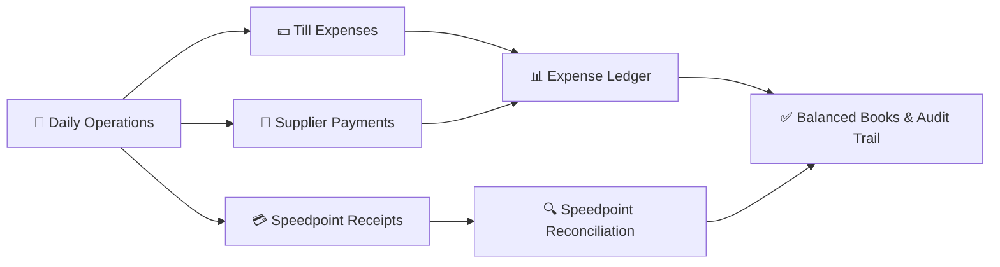

<div align="center">

# 🧾 Accounting Package — Expenses

**A streamlined Python web application for tracking till expenses, managing supplier payments, and reconciling speedpoint transactions.**

[](https://www.python.org/)
[](https://www.docker.com/)
[](https://docs.docker.com/compose/)
[](https://github.com/Devon-GS/Accounting-Package-Expenses/actions)

[](https://github.com/Devon-GS/Accounting-Package-Expenses/commits/main)
[](https://github.com/Devon-GS/Accounting-Package-Expenses/commits/main)
[](https://github.com/Devon-GS/Accounting-Package-Expenses)
[](https://github.com/Devon-GS/Accounting-Package-Expenses/issues)

[Overview](#-overview) •
[Key Features](#-key-features) •
[Workflow](#-accounting-workflow) •
[Project Structure](#-project-structure) •
[Getting Started](#-getting-started) •
[Configuration](#-configuration)

</div>

---

## 📖 Overview

**Accounting-Package-Expenses** is designed to simplify day-to-day financial recordkeeping for retail and point-of-sale environments. Instead of juggling spreadsheets for petty cash, vendor payouts, and card terminal settlements, it brings all three operational workflows together under one containerized web application.

---

## ✨ Key Features

| Module | Description |
| :--- | :--- |
| 💵 **Till Expense Tracking** | Log, categorize, and audit expenses paid directly out of the till to keep daily cash-ups accurate. |
| 🚚 **Supplier Payments** | Record and monitor outgoing payments to suppliers, helping maintain clear accounts payable visibility. |
| 💳 **Speedpoint Reconciliation** | Reconcile card terminal (speedpoint) transactions against expected settlements to catch discrepancies early. |
| 🐳 **Containerized Deployment** | Includes a `Dockerfile`, `docker-compose.yml`, and dedicated `docker/` setup for consistent deployment across environments. |
| ⚙️ **Automated Workflows** | Integrated `.github/workflows` pipelines for automated checks and continuous integration. |

---

## 🔄 Accounting Workflow



---

## 🧱 Tech Stack

- **Backend:** Python (`app.py`)
- **Frontend:** Server-rendered HTML templates (`templates/`) & static assets (`static/`)
- **Containerization:** Docker & Docker Compose (`Dockerfile`, `docker-compose.yml`, `docker/`)
- **CI/CD:** GitHub Actions (`.github/workflows/`)

---

## 📁 Project Structure

```text
Accounting-Package-Expenses/
├── .github/
│   └── workflows/          # CI/CD automation pipelines
├── docker/                 # Supporting Docker configurations & scripts
├── static/                 # CSS, JavaScript, and static assets
├── templates/              # HTML templates for the web UI
├── .dockerignore           # Files excluded from Docker build context
├── .env.example            # Template for required environment variables
├── .gitattributes          # Git path attributes
├── .gitignore              # Ignored files and directories
├── Dockerfile              # Container image definition
├── app.py                  # Main Python application entry point
├── docker-compose.yml      # Multi-container / service orchestration
└── requirements.txt        # Python package dependencies
```

---

## 🚀 Getting Started

### Prerequisites

Choose your preferred way to run the project:
- **Docker path:** [Docker](https://docs.docker.com/get-docker/) & [Docker Compose](https://docs.docker.com/compose/install/)
- **Local path:** Python 3.x & `pip`

---

### Option 1: Run with Docker Compose (Recommended)

1. **Clone the repository**
   ```bash
   git clone https://github.com/Devon-GS/Accounting-Package-Expenses.git
   cd Accounting-Package-Expenses
   ```

2. **Create your environment file**
   ```bash
   cp .env.example .env
   ```
   > Update `.env` with your local configuration values before starting the containers.

3. **Build and start the application**
   ```bash
   docker compose up -d --build
   ```

4. **Check container logs**
   ```bash
   docker compose logs -f
   ```

---

### Option 2: Run Locally with Python

1. **Clone the repository**
   ```bash
   git clone https://github.com/Devon-GS/Accounting-Package-Expenses.git
   cd Accounting-Package-Expenses
   ```

2. **Create and activate a virtual environment**
   ```bash
   python -m venv venv
   source venv/bin/activate        # On Windows: venv\Scripts\activate
   ```

3. **Install dependencies**
   ```bash
   pip install -r requirements.txt
   ```

4. **Configure environment variables**
   ```bash
   cp .env.example .env
   ```

5. **Run the application**
   ```bash
   python app.py
   ```

---

## ⚙️ Configuration

Environment configuration is managed via `.env` (based on `.env.example`). Copy the template and populate all required values before running in development or production:

```bash
cp .env.example .env
```

> 💡 **Tip:** Never commit your `.env` file or sensitive credentials to version control.

### Production HTTPS

For production, terminate TLS at a trusted reverse proxy or load balancer in front of Gunicorn. Forward only HTTPS traffic to the application and set:

```dotenv
FLASK_ENV=production
SESSION_COOKIE_SECURE=true
SESSION_SECRET=<long-random-secret>
SESSION_VERSION=1
```

`SESSION_COOKIE_SECURE=true` ensures authenticated cookies are sent only over HTTPS. Increment `SESSION_VERSION` to invalidate all existing sessions after a credential or security incident. Keep the Docker PostgreSQL port bound to `127.0.0.1`; production deployments should use Neon or a private database network rather than exposing PostgreSQL publicly.

Local development intentionally defaults to `FLASK_ENV=development` and insecure cookies so `http://localhost:5000` continues to work.

<!-- --- -->

<!-- ## 🤝 Contributing

Contributions, issues, and feature requests are welcome!

1. Fork the repository
2. Create your feature branch (`git checkout -b feature/amazing-feature`)
3. Commit your changes (`git commit -m 'Add some amazing feature'`)
4. Push to the branch (`git push origin feature/amazing-feature`)
5. Open a Pull Request -->

<!-- --- -->

<!-- ## 📝 License -->

<!-- Update this section with your chosen license (e.g., MIT, Apache-2.0, Proprietary) -->
<!-- Specify your project license here (e.g., add a `LICENSE` file to the root directory). -->

<!-- --- -->

<div align="center">
  <sub>Built by <a href="https://github.com/Devon-GS">Devon-GS</a> • <a href="#-accounting-package--expenses">Back to top ↑</a></sub>
</div>
